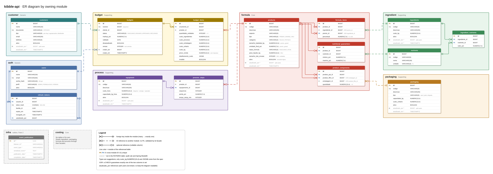

# Diagrama ER



- `er-diagram.drawio`: fonte editável. Abra no [draw.io](https://app.diagrams.net) ou na extensão do VS Code/IntelliJ.
- `er-diagram.png`: imagem exportada a partir da fonte.

A fonte da verdade é a tabela da Fase 1 em [`../ROTEIRO.md`](../ROTEIRO.md). Ao mudar a modelagem, atualize o roteiro, o diagrama e exporte a imagem de novo.

## Convenções do diagrama

- Cada módulo é uma moldura, e cada tabela fica dentro do módulo dono.
- Linha contínua: chave estrangeira dentro do módulo.
- Linha tracejada: referência a outro módulo só por ID, sem chave estrangeira, validada pela fachada do módulo dono.
- A cor da linha é a do módulo da tabela referenciada.
- Colunas em cinza com `*` não estão na tabela do roteiro: vêm da regra de auditoria e do Spring Modulith.

## Exportar a imagem

```sh
docker run --rm --shm-size=2g -e DRAWIO_DESKTOP_COMMAND_TIMEOUT=300s \
  -w /data -v "$PWD/docs/database:/data" rlespinasse/drawio-desktop-headless \
  -x -f png --scale 1.5 -b 30 -o er-diagram.png er-diagram.drawio
```

- Sem `--shm-size`, o renderizador do Electron cai por falta de memória compartilhada.
- `--scale 2` estoura o limite de canvas nessa largura e a exportação não termina.
- Não use o estilo de pulo de linha (`jumpStyle`) nas conexões: ele trava a exportação sem interface.
